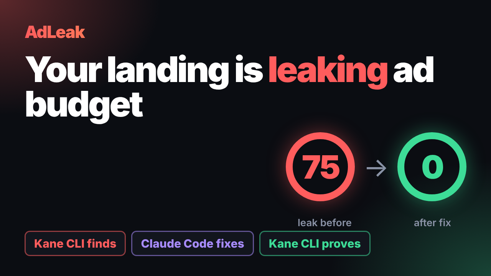

# AdLeak 💸🔍

**Your landing page is leaking ad budget. AdLeak finds the leak in a real browser with [Kane CLI](https://www.testmuai.com/kane-cli/), lets Claude Code fix it, and has Kane prove the fix.**

🎥 **Demo video:** https://www.youtube.com/watch?v=zxxuCp4ISco
🌐 **Landing:** https://muhamed-kanapiya.github.io/adleak/



Businesses pay for every Google Ads and Meta click. Then a typo in a button anchor, a form posting to the wrong endpoint, UTM tags that never reach the CRM, a Meta pixel that fires twice, a promo popup that covers the button on phones, or a slow chat widget quietly burns that budget. Linters and unit tests don't catch any of it, because these bugs only show up when a real visitor clicks through the page.

AdLeak plays that visitor with Kane CLI. It turns what Kane finds into a **budget leak score** (and $/day at risk), then runs a closed loop:

```
          ┌───────────────────── closed loop ─────────────────────┐
          ▼                                                       │
  Kane CLI audit  ── failures, evidence, measured values ──▶  Claude Code (headless)
  real Chrome, NDJSON verdicts,                               patches HTML / JS / copy
  network + console + Web Vitals  ◀────── re-verify ──────────  file tools only
          │
          └─ all green ─▶ full regression pass ─▶ report (before / after, $ recovered)
```

The agent can edit code but can't declare success. Only Kane can.

## What it checks

| Check | What Kane does | Why it costs money |
|---|---|---|
| `cta` | Clicks the hero CTA without scrolling, checks the form came into view | Paid click → dead button → bounce |
| `form` | Fills and submits the lead form, checks for success | Lead lost at the last step |
| `utm` | Opens with UTM tags, submits, inspects the outgoing request | No attribution, so you can't cut losing campaigns |
| `pixels` | Captures every Google Ads / GA4 / Meta / Yandex Metrica / TikTok hit after a lead; AdLeak verifies **each expected platform fires exactly once** | Missing conversions → blind bidding; **double-fired** ones → bidding trained on fake data |
| `mobile` | Phone-size window: is the CTA visible and not covered by a popup, and does tapping it work? | Most paid traffic is mobile |
| `speed` | Measures LCP / CLS (Core Web Vitals) | Slow first screen loses visitors and hurts landing-page experience |
| `match` | With `--ad "<headline>"`: does the first screen repeat the ad's promise (product, price, timing)? | Message mismatch → bounces and a lower Quality Score, so higher CPC |
| `health` | Asserts no console errors and no failed requests | Broken scripts kill forms and tracking |

Each check is a plain-English Kane objective in `src/checks.js`, so adding one takes a few lines.

## Quick start

Requirements: Node 18+, [Kane CLI](https://www.testmuai.com/support/docs/kane-cli-introduction/) (`npm i -g @testmuai/kane-cli && kane-cli login --oauth`), and [Claude Code](https://docs.claude.com/en/docs/claude-code) (`claude` on PATH, logged in) for `fix`.

```bash
npm install
npm run demo:reset     # restore the intentionally broken demo landing
npm run demo:serve     # terminal 1 → http://localhost:4321
npm run fix:demo       # terminal 2 → audit → fix → verify → regression
```

Then open `adleak-report/index.html`.

## Usage

```bash
# Audit any URL (read-only checks + tag inventory, no fake leads sent)
adleak audit https://your-landing.com --no-submit --budget 100

# Full audit of your own landing, with message match and pixel expectations
adleak audit https://your-landing.com --budget 100 --ad "Implants in 1 day from 150 000 KZT" --expect google_ads,ga4,meta

# Audit + auto-fix a site you serve locally
adleak fix http://localhost:3000 --dir ./public --max-iter 3 --budget 100

# Agency mode: one URL per line → report per site + leaderboard (never submits forms)
adleak audit clients.txt --out leaks
```

Options: `--only cta,pixels` (subset), `--budget <usd/day>`, `--ad "<headline>"`, `--expect <platforms>`, `--no-submit`, `--context "<hint for the agent>"`, `--headed` (watch the browser), `--model <claude-model>`, `--out <dir>`.

Every run writes `index.html` (the visual report), `report.json` and `summary.md` (a PR-ready table).

## In CI: block PRs that break conversions

```yaml
- uses: <owner>/adleak@main
  with:
    url: http://localhost:3000
    start-command: npm run preview
    expect: google_ads,ga4,meta
    budget: "100"
    username: ${{ secrets.LT_USERNAME }}
    access-key: ${{ secrets.LT_ACCESS_KEY }}
```

The action installs Chrome and Kane CLI, runs the audit and posts the leak table as a sticky PR comment. It uploads the full report as an artifact and fails the check if anything leaks. See `.github/workflows/adleak.yml`.

## The demo landing

`demo/template` is a realistic dental clinic landing page with the bugs agencies ship every week:

1. CTA anchor typo (`#lead-from`)
2. Form posts to `/api/leads` (404)
3. UTM keys read as `utm-source` instead of `utm_source`
4. Google Ads conversion guarded by a variable nobody sets
5. Yandex Metrica reads a counter ID key renamed in a redesign → no hits at all
6. A "just in case" legacy snippet fires the **Meta Lead event twice**
7. A promo popup covers the CTA on phones
8. A synchronous third-party chat widget blocks rendering (LCP ≈ 3.2 s)
9. The hero doesn't repeat the ad's promise (price, "1 day")
10. `initCarousel()` is called but never defined

The demo server logs `📥 Lead received` and `💰 Conversion` in real time, so you can watch the fixes land. `npm run demo:reset` restores the broken version.

## How Kane and the agent talk

- `src/kane.js` spawns `kane-cli run "<objective>" --agent --headless`, then parses the NDJSON stream (progress steps, the `run_end` verdict and values Kane stored with "store … as") along with the exit code. Auth and infra errors stop the loop instead of being "fixed".
- `src/pixels.js` classifies the captured tracking URLs by platform and counts lead events per lead. It collapses Google Ads' redirect chain, so one conversion counts once.
- `src/agent.js` builds the fix prompt from Kane's verdicts, evidence (`POST /api/leads -> 404`, `initCarousel is not defined`), measured values (`Meta Pixel: 2× conversions`, `LCP 3.21 s`) and the business impact, then runs `claude -p` with file-edit tools only. Failed attempts are fed into the next round.

## Built with

Kane CLI (TestMu AI) · Claude Code · Node.js

Built for the [Kane CLI Online Hackathon](https://www.kaneclihack.sh/) by [Kanapiya.tech](https://kanapiya.tech).

MIT License.
